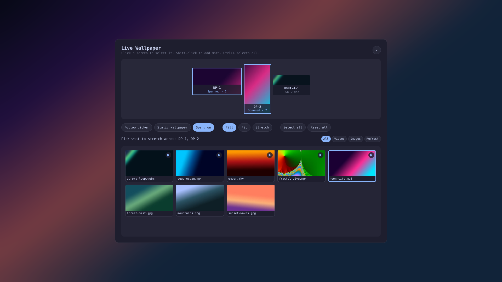

# Omarchy Live Wallpaper

Play fast, muted, looping video wallpapers through Omarchy's familiar
**Style → Background** picker. The plugin keeps the stock background service
and adds video support without starting another Quickshell process.




## Quick start

1. Copy an MP4, MKV, WebM, MOV, or M4V file into your current theme's folder:

   ```text
   ~/.config/omarchy/backgrounds/<theme-name>/
   ```

2. Open **Style → Background**.
3. Select the video's generated preview.

Playback starts automatically with no shell restart. To stop the video, open
the picker again and select a normal image. You can also double-click an empty
part of the desktop to open the picker.

## Features

- Lists images and videos together from the active theme's wallpaper folders
- Supports MP4, MKV, WebM, MOV, and M4V
- Starts cached videos in about 100 ms using persistent Qt multimedia surfaces
- Keeps one warm, muted, looping player per connected monitor
- Per-monitor wallpapers: each screen follows the picker, shows its own video
  or image, or keeps the static wallpaper
- Spanning: stretch one video or image across neighbouring screens, laid out
  exactly as Hyprland arranges them, with followers kept in sync with a leader
- A screen editor you open from the bar, the Omarchy menu, or the CLI
- Pauses a screen's video while a fullscreen app covers it, and resumes when
  it leaves (can be turned off)
- Reveals video only after the first valid frame, preventing black flashes
- Generates picker previews with Omarchy's existing `ffmpeg` installation
- Keeps a static poster as the lock-screen and transition fallback
- Stops playback when a static wallpaper or another theme is selected
- Resumes the selected video after the Omarchy shell restarts
- Preserves desktop double-click behavior through the video/input surface

## Multiple monitors

Open the screen editor in any of these ways:

- click the **Live Wallpaper** icon in the bar (right click opens the picker)
- **Appearance → Live Wallpaper Screens** in the Omarchy menu
- `~/.config/omarchy/plugins/lucentdread.live-wallpaper/live-wallpaper.sh --settings`

The editor draws your monitors as Hyprland arranges them. Click a screen to
select it (Shift-click to add more, Ctrl+A for all), then:

| Action | Result |
|---|---|
| **Follow picker** | The screen shows whatever Style → Background selects (the default) |
| **Static wallpaper** | No video on that screen; Omarchy's static wallpaper shows through |
| Click a video or image | Each selected screen shows it on its own |
| **Span: on** + click a video or image | One picture stretched across all the selected screens |
| **Fill / Fit / Stretch** | How the picture fits its screen or span |

A span uses the bounding box of its screens, so gaps and offsets between
monitors are respected and the picture lines up across bezels. Every screen
decodes its own copy of the video; the first (left-most) screen leads and the
others nudge their playback rate or seek to stay in step with it.

The editor lists videos and images from every folder under
`~/.config/omarchy/backgrounds/` (any theme, any subfolder) and from the active
theme. Per-monitor choices survive theme switches and shell restarts; only
screens on **Follow picker** react to Style → Background.

### Fullscreen apps

While a fullscreen app (a game, a video, `Super+F`) covers a screen, that
screen's video pauses on its last frame and stops decoding; it resumes as
soon as the app leaves fullscreen or you switch workspace. Maximized windows
do not pause it, since the wallpaper still shows around the bar and gaps. In a
span, only the covered screens pause; they catch up with the others when they
resume. Turn it off with **Pause behind fullscreen** in the editor's header.

The layout lives in `~/.local/state/omarchy/live-wallpaper/layout.json` and can
also be driven over IPC:

```bash
omarchy-shell lucentdread.live-wallpaper screens
omarchy-shell lucentdread.live-wallpaper setScreen DP-1 media ~/.config/omarchy/backgrounds/live/ocean.mp4
omarchy-shell lucentdread.live-wallpaper span DP-1,DP-2 ~/.config/omarchy/backgrounds/live/city.mp4
omarchy-shell lucentdread.live-wallpaper setFit DP-1,DP-2 fit
omarchy-shell lucentdread.live-wallpaper setScreen HDMI-A-1 none ""
omarchy-shell lucentdread.live-wallpaper resetLayout
omarchy-shell lucentdread.live-wallpaper pauseOnFullscreen false
```

### Bar icon

Enabling the plugin places its icon in the right section of the bar. Move it
with `omarchy bar move lucentdread.live-wallpaper --section <section>`. The plugin
is enabled for as long as its icon is on the bar, so removing the icon also
stops the wallpapers. If the icon is missing, add it with
`omarchy bar put lucentdread.live-wallpaper`.

## Compatibility

Works on all Omarchy channels: stable, rc, edge, and dev. It needs the Omarchy
Quickshell shell with third-party `service` plugin support, the `omarchy-shell`
CLI, and the shell's stable `image-selector` IPC target. Those are present and
unchanged from Omarchy v4.0.6 onward through the latest dev build, so no
channel-specific setup is required.

The plugin's QML depends only on core Quickshell and Qt Multimedia, not on any
shell-internal QML module, so the shell's third-party plugin capability
restrictions do not affect it.

## Install

```bash
omarchy plugin add https://github.com/LucentDread/omarchy-live-wallpaper.git --enable
```

No additional packages or privileged installation steps are required. Playback
uses Qt Multimedia from Omarchy's existing Qt runtime, and previews use the
existing `ffmpeg` command. The plugin does not start another Quickshell process.

## Use

Place videos beside image wallpapers in either location:

- `~/.config/omarchy/backgrounds/<theme-slug>/`
- `<theme>/backgrounds/`

Open **Style → Background** or double-click an empty part of the desktop. Video
entries use a generated frame in the picker and start moving after selection.

### Menu integration

Enabling the plugin updates the Background action in
`~/.config/omarchy/extensions/omarchy-menu.jsonc` (`appearance.background` on
Omarchy Quattro, `style.background` on older releases) and adds a
**Live Wallpaper Screens** entry beside it. The stock **Background** name,
icon, and aliases are preserved; only its picker action changes.

Disabling or removing the plugin through Omarchy unloads the service and removes
the menu override. It can also be removed manually without disabling playback:

```bash
~/.config/omarchy/plugins/lucentdread.live-wallpaper/live-wallpaper.sh --unwire-menu
```

## Update

```bash
omarchy plugin update lucentdread.live-wallpaper
```

## Remove

Standard removal performs complete cleanup before deleting the plugin. It stops
playback, restores the last static wallpaper, deletes generated state/cache,
and removes the **Style → Background** integration:

```bash
omarchy plugin remove lucentdread.live-wallpaper
```

## Development

```bash
PLUGIN_DIR="$HOME/.config/omarchy/plugins/lucentdread.live-wallpaper"
omarchy plugin validate "$PLUGIN_DIR"
/usr/lib/qt6/bin/qmllint -I "${OMARCHY_PATH:-/usr/share/omarchy}/shell" "$PLUGIN_DIR/Service.qml"
bash -n "$PLUGIN_DIR/live-wallpaper.sh"
```

The repository root is the plugin folder:

- `manifest.json` declares the standalone service entry point
- `Service.qml` owns persistent players, the per-monitor layout, span sync,
  IPC, desktop input, and resume
- `Settings.qml` is the screen editor panel
- `BarWidget.qml` is the bar icon that opens it
- `live-wallpaper.sh` owns media discovery, `ffmpeg` previews, state, and cleanup

Runtime state is stored under `~/.local/state/omarchy/live-wallpaper/`; generated

## Credits

Based on [live-wallpaper](https://github.com/yesheytenzin/live-wallpaper) by
Yeshey Tenzin, released under the MIT License. This project adds per-monitor
wallpapers, spanning across screens, and the screen editor.

## License

Licensed under the MIT License. See [`LICENSE`](LICENSE).
